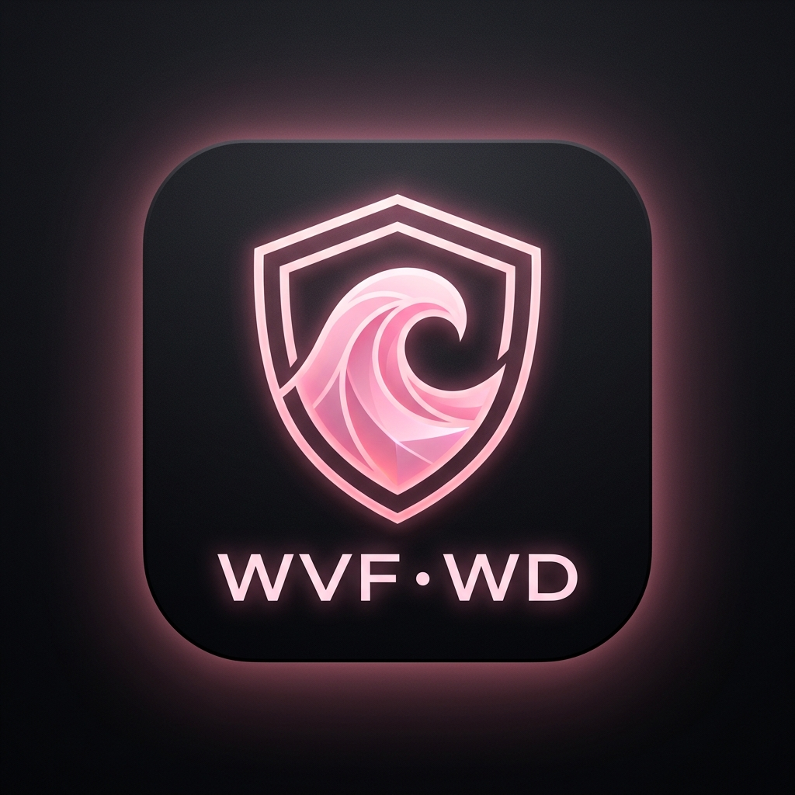

<p align="center">
  
</p>

<h1 align="center" style="font-weight: 800; color: #ff85a1;">✦ WVF · WD ✦</h1>

<p align="center">
  <b>Мультиплатформенный клиент протокола QWDTT</b><br>
  <i>Безопасное туннелирование через TURN-инфраструктуру медиазвонков VK в стиле Pink Noir</i>
</p>

<p align="center">
  <a href="https://github.com/VansFenix/WVF-WD/releases/latest"></a>
  
  
  
  
</p>

---

## 🌸 О проекте WVF WD

**WVF WD** (*Wave Voice Forward — WireGuard Disguise*) — форк и расширенная версия клиента протокола **QWDTT** с полной поддержкой **Windows**, **Linux** и **Android**, переработанным визуальным оформлением в эстетичном черно-нежно-розовом стиле (**Pink Noir**) и набором готовых установщиков.

Приложение инкапсулирует зашифрованный сетевой трафик в медиапотоки WebRTC (RTP с криптографией AEAD и HKDF) и передаёт их через официальные TURN-серверы звонков VK. Для любого DPI и сетевых анализаторов ваше соединение выглядит как обычный голосовой или видеозвонок ВКонтакте, а не как прямой VPN-туннель.

---

## ✨ Ключевые возможности

### 🎨 Эстетика WVF Pink Noir
* Глубокий обсидиановый фон (`#07070A`, `#0E0D14`) с неоновым свечением и нежно-пастельными розовыми акцентами (`#FF85A1`, `#FFAEC0`, `#FFD9E2`).
* Фирменный логотип с защитным щитом и волновым контуром.
* Плавные анимации, пульсирующие индикаторы статуса соединения и живой график скорости.

### 🌐 Поддержка всех режимов туннелирования
* **SOCKS5 (Userspace)**: локальный прокси `127.0.0.1:1080`, не требующий прав администратора.
* **WireGuard VPN**: полноценный туннель на сетевом уровне с интеграцией netstack.
* **Raw (RAW-IP)**: прямой обмен пакетами через сокет с авто-переключением userspace на десктопе.

### 💻 Windows
* **Полноценный установщик NSIS**: `WVF-WD-Setup-v2.0.0.exe` с ярлыком на рабочем столе, меню «Пуск» и деинсталлятором.
* **Портативная версия**: `WVF-WD-Portable-v2.0.0.exe` (запуск без установки).
* **Мгновенный системный прокси**: вызов WinINet API (`InternetSetOption`) мгновенно перенаправляет весь трафик браузеров (Chrome, Edge, Яндекс) в туннель без перезагрузки системы.
* **Проверка внешнего IP в 1 клик**: встроенная кнопка тестирования внешнего IP и геолокации.

### 🐧 Linux
* **Официальный скрипт установки**: `setup-linux.sh` (установка в `/opt/wvf-wd` или `~/.local/share/wvf-wd`, регистрация ярлыка в системном меню приложений и добавление команды `wvf-wd` в терминал).
* Поддержка системного сервиса `systemd` для круглосуточной фоновой работы.
* Скомпилированные бинарники ядра под архитектуры **x86_64** и **ARM64**.

### 📱 Android
* Самостоятельный пакет `net.wvf.wd` с названием **WVF WD** (устанавливается рядом с любыми старыми версиями без конфликтов).
* Чистый интерфейс без посторонних всплывающих окон и запросов донатов.
* Виджет рабочего стола и плитка быстрого переключения в системной шторке (Quick Settings Tile).
* Поддержка файлов и ссылок `qwdtt://` и `wvfwd://`.

---

## 📦 Готовые пакеты для загрузки

Все файлы доступны в разделе [Releases на GitHub](https://github.com/VansFenix/WVF-WD/releases):

| Операционная система | Файл | Описание |
| :--- | :--- | :--- |
| **🪟 Windows (Установщик)** | `WVF-WD-Setup-v2.0.0.exe` | Официальный мастер установки с ярлыками и интеграцией в систему |
| **🪟 Windows (Портативный)** | `WVF-WD-Portable-v2.0.0.exe` | Автономный запуск в 1 клик без установки |
| **🪟 Windows (Архив)** | `WVF-WD-Desktop-Windows-v2.0.0.zip` | Легковесный архив с веб-клиентом и `Запуск WVF WD.bat` |
| **🐧 Linux (Установщик)** | `setup-linux.sh` | Установочный скрипт в системное меню и PATH |
| **🐧 Linux (Архив)** | `WVF-WD-Desktop-Linux-v2.0.0.tar.gz` | Полный дистрибутив для x86_64 и ARM64 с systemd-сервисом |
| **📱 Android (ARM64)** | `wvf-wd-arm64-v8a-v2.0.0.apk` | Оптимизированный APK для современных 64-битных смартфонов |
| **📱 Android (Универсальный)** | `wvf-wd-universal-v2.0.0.apk` | Универсальный APK для всех архитектур Android |

---

## 🚀 Инструкция по установке и запуску

### 1. Windows

#### Вариант A — Официальный установщик (Рекомендуется):
1. Скачайте `WVF-WD-Setup-v2.0.0.exe` и запустите его.
2. Следуйте подсказкам мастера установки. На рабочем столе появится ярлык **WVF WD**.
3. Запустите приложение, введите параметры сервера и нажмите **ПОДКЛЮЧИТЬ**.

#### Вариант B — Портативный:
1. Скачайте `WVF-WD-Portable-v2.0.0.exe` и запустите.
2. Приложение сразу откроется в черно-нежно-розовом окне с треем.

---

### 2. Linux

1. Скачайте архив `WVF-WD-Desktop-Linux-v2.0.0.tar.gz` и распакуйте его:
```bash
tar -xvf WVF-WD-Desktop-Linux-v2.0.0.tar.gz
cd wvf-wd
```
2. Запустите установщик:
```bash
# Для установки для текущего пользователя:
./setup-linux.sh

# Или для общесистемной установки (в /opt):
sudo ./setup-linux.sh
```
3. После установки приложение доступно:
   * В системном меню программ: **WVF WD**
   * Из любого терминала: командой `wvf-wd`

---

### 3. Android

1. Скачайте `wvf-wd-arm64-v8a-v2.0.0.apk` (или универсальный APK) на смартфон.
2. Разрешите установку из неизвестных источников и установите приложение.
3. Откройте **WVF WD**, добавьте ваш профиль VPS или вставьте ссылку `qwdtt://`.
4. Нажмите **«Подключить»** и разрешите создание VPN-соединения.

---

## ⚙️ Управление профилями и импорт

WVF WD поддерживает импорт ссылок и файлов:
* **Формат ссылки**:
  `qwdtt://config?peer=1.2.3.4:9000&pass=secret&hashes=hash1,hash2&mode=socks`
  или `wvfwd://config?...`
* **Файлы конфигураций**: `.qwdtt`, `.conf`, `.json`.
* **VK Хеши**: поддерживаются как прямые 64-символьные хеши (SHA-256), так и полные ссылки на звонки формата `vk.com/call/join/...`.

---

## 🛠 Структура репозитория

```
WVF-WD/
├── app/                  # Android-клиент (Jetpack Compose, Material 3, VpnService)
├── desktop/              # Настольное приложение (Electron GUI, веб-панель, трей)
├── go_client/            # Высокопроизводительное ядро QWDTT на Go
├── server/               # Серверная часть QWDTT для VPS
├── assets/               # Фирменный логотип и иконки WVF WD
├── dist/                 # Готовые дистрибутивы для загрузки (APK, EXE, TAR.GZ)
├── setup-linux.sh        # Системный установщик для Linux
├── run-windows.bat       # Быстрый лаунчер для Windows
├── run-linux.sh          # Быстрый лаунчер для Linux
└── scripts/              # Вспомогательные скрипты упаковки и сборки
```

---

## 📜 Лицензия

Проект распространяется по лицензии [GNU General Public License v3.0](LICENSE).  
Основан на разработках протокола QWDTT и открытой кодовой базе WDTT.
